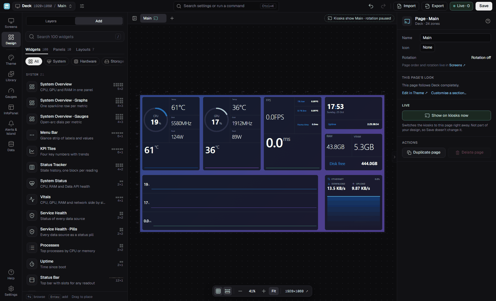

# InfoPanel Studio

[](https://github.com/F3NN3X/InfoPanel.Studio/releases)


Design live sensor dashboards for [InfoPanel](https://github.com/habibrehmansg/infopanel) and show them on a second screen, a small panel or any browser on your network.
You lay out widgets in a studio, and a local server serves the result as a full screen page that updates as your sensors change.



## What you get

- A studio to design screens: drag widgets onto a grid, resize them, undo any edit, and see saved changes appear on the display within about a second.
- More than 60 widgets for system load, temperatures, fans, drives, network, frame rate, clocks, weather, calendars, media and more, and a library of your own panels, styles, gauges, images, videos and fonts.
- 24 screen templates to start from, each made for a standard, wide, strip or tall panel.
- Themes: one place to set colours, type, shape and spacing for every screen, one screen or one page, with ready-made skins and palettes you can save as your own.
- InfoPanel import and export. Open an `.infopanel` profile as a screen, edit it in a canvas editor, and write it back out as an `.infopanel` file that InfoPanel itself reads.
- A kiosk page for your panels: open it in InfoPanel's Web Page mode, in a browser, or on any device that can reach the server.
- A Dynamic Island and alerts: a pill at the top of the kiosk that shows the time or a live value and opens for alerts such as a Data API disconnect.
- Coding agents: show what Claude Code and Codex are doing, live, on widgets. It is off until you turn it on in Settings.
- A Windows app with a tray icon that keeps the server running with the window closed, can start at login, and updates itself from GitHub releases on a stable or beta channel.

Help is built into the app, under Help on the rail.

## Install

1. Download `InfoPanel Studio_<version>_x64-setup.exe` from the [latest release](https://github.com/F3NN3X/InfoPanel.Studio/releases) and run it.
2. It installs for your user only, so it needs no admin rights. The installer is unsigned, so Windows SmartScreen warns on the first run.
3. Start InfoPanel Studio. The first time it opens with no saved dashboard, a short setup walks you through connecting the Data API and making a first screen.

After that the app checks for updates by itself. Settings > Updates lets you pick the channel (stable or beta), turn the check off or download in the background. Settings > Changelog lists the last 10 releases.

Your dashboards are stored in `%LOCALAPPDATA%\InfoPanel\Dashboard`.

## Requirements

- Windows 10 or 11, 64 bit.
- InfoPanel with the Data API, installed and running, with the Data API turned on in its Settings. That is where every sensor value comes from. By default the studio looks for it at `http://127.0.0.1:3921`, and you can change the address in the studio.
- Some widgets need an InfoPanel plugin: `wavelink-plugin` for Wave Link, `yr-weather-plugin` for the weather forecast, and `InfoPanel.Notifications` 2.0 or newer for alerts from Windows notifications.

## Quick start

1. Open the studio, press Screens on the rail, then New.
2. Pick a template, pick the size of your panel, and press Create screen.
3. In Design, add or move widgets. Any widget with a sensor has a Data tab to choose the reading.
4. Open Settings > Server and copy the kiosk URL.
5. In InfoPanel, make a profile for your panel, turn on Web Page mode and paste the URL. For a particular screen, add `&profile=<profile id>` to it:

```
http://127.0.0.1:3922/?kiosk=1&profile=<profile id>
```

`kiosk=1` hides the header and the studio button. `page=<page id>` pins one page of a profile. Without `profile`, the kiosk shows the screen pinned in the studio, or the one that best fits the window.

## Limitations

InfoPanel Studio is in beta. Expect rough edges, and expect screens you make today to change as templates and widgets do.

- It runs on Windows only.
- The sensors come from InfoPanel, and only a version of InfoPanel with the Data API can serve them. When InfoPanel is not installed, not running or its Data API is off, widgets show dashes or zeros. If a sensor is renamed after a driver or hardware change, pick it again in the widget's Data tab.
- A screen from a template was drawn against one PC's sensors. Some widgets may need a sensor picked again on your PC.
- The installer is unsigned, so SmartScreen warns when you first run it.
- The server listens on this PC only until you change Settings > Server to Local network. Other devices can then view the kiosk, but they can edit only if you also turn on Allow editing from other devices.
- An `.infopanel` export cannot carry everything the studio can do. InfoPanel has no letter spacing, text gradients, blurred text shadows or gradient fills under a graph, and it cannot blur what is behind an item. The export approximates some of these and lists them. Fonts are not in the file, so the other PC needs them installed. InfoPanel matches HWiNFO sensors by name and Libre and plugin sensors by id, so those sensors have to exist on the other PC.
- The studio's own widgets have no InfoPanel equivalent. Converting a screen to an InfoPanel profile is experimental, and Coding Agents, Countdown, Timer, Web Page, Wave Link, Day Planner, Radial Clock Stack and On-Air Beacon are left out of it.
- Turning on coding agents edits hook entries in `~/.claude/settings.json` and `~/.codex/hooks.json`. Codex asks you to approve the hooks once with `/hooks`.
- Installing an update restarts the app and the server, so the display is blank for about 10 seconds.

Known problems and fixes are in the Help article Common problems. Report bugs and ideas as [GitHub issues](https://github.com/F3NN3X/InfoPanel.Studio/issues).

## Links

- [Releases](https://github.com/F3NN3X/InfoPanel.Studio/releases) and the [changelog](CHANGELOG.md)
- [Issues](https://github.com/F3NN3X/InfoPanel.Studio/issues)
- Help is inside the app. The files in [docs/](docs/README.md) are for developers.

## For developers

You need Node.js 20 or newer and a stable Rust toolchain.

```bash
npm install
npm run serve
```

This builds the web app, then runs the server (`ips-server`) on `http://127.0.0.1:3922`. The first run compiles the server. `npm run desktop:build` makes the installer.

[docs/development.md](docs/development.md) covers the scripts, CI and releases, and [docs/TESTING.md](docs/TESTING.md) covers the tests and `npm run verify`. The [docs index](docs/README.md) lists the architecture, the server contract, the customization guide and the widget catalog.
